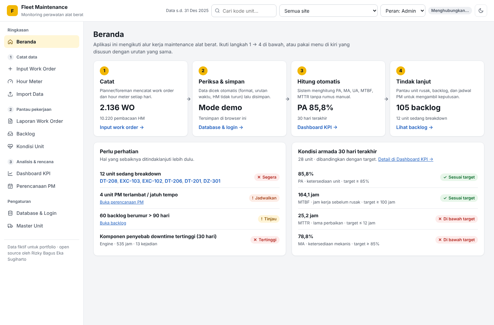
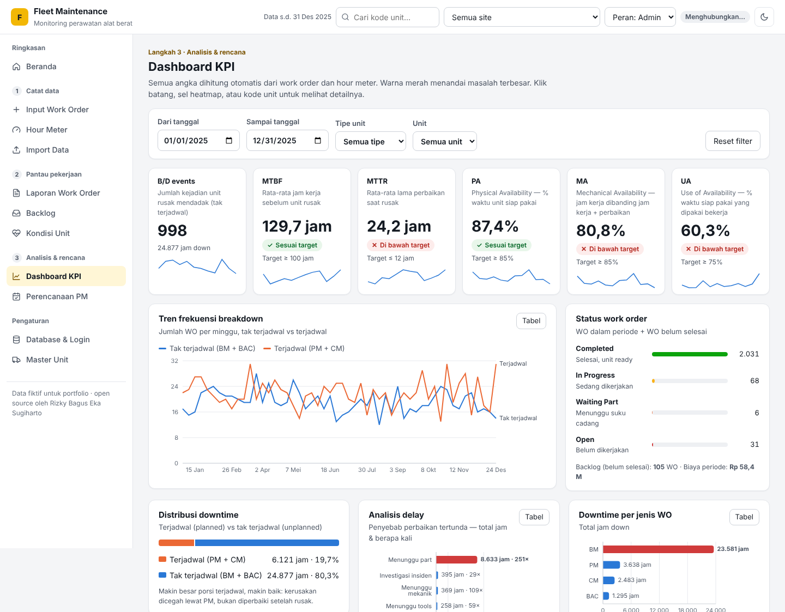

# Fleet Maintenance & Reliability Dashboard

Aplikasi web untuk memonitor **maintenance & reliability armada alat berat**:
planner/foreman menginput work order dan hour meter, lalu sistem otomatis
menghitung KPI (PA, MA, UA, MTBF, MTTR, backlog, PM compliance) dan
menampilkannya sebagai dashboard interaktif.

Pengembangan dari dashboard Power BI saya menjadi aplikasi web end-to-end
dengan database dan login.

**Demo:** https://rizkysugiharto-eng.github.io/fleet-maintenance-dashboard/





> Semua data **fiktif**: Site A berasal dari dataset latihan Power BI saya
> (`data/raw/`), Site B dibuat oleh generator data dummy. Bukan data perusahaan mana pun.

## Fitur

Menu disusun mengikuti alur kerja: **① Catat data → ② Pantau pekerjaan → ③ Analisis & rencana**.

| Menu | Isi |
|---|---|
| **Beranda** | Penjelasan alur kerja 4 langkah dengan angka live, daftar yang perlu ditindaklanjuti, kondisi armada 30 hari vs target |
| **Dashboard KPI** | 6 KPI dengan target & tren (B/D events, MTBF, MTTR, PA, MA, UA), tren breakdown terjadwal vs tak terjadwal, status WO, distribusi downtime, analisis delay, heatmap ketersediaan armada (klik sel → daftar WO), ringkasan per tipe unit, PA per unit, pareto komponen |
| **Kondisi Unit** | Kartu per unit: Breakdown / Perlu perhatian / Sehat, PA 30 hari, MTBF, sisa HM ke PM |
| **Detail unit** | Klik kode unit di mana saja (atau cari di header): ringkasan, riwayat WO, grafik HM, KPI bulanan, repeat breakdown |
| **Laporan Work Order** | Cari & filter, ubah status, tutup WO, export CSV |
| **Input Work Order** | Form dengan validasi (unit, jenis, komponen, waktu, delay, biaya) |
| **Hour Meter** | Input pembacaan HM harian dengan validasi (tidak boleh turun / > 24 jam per hari) |
| **Perencanaan PM** | Forecast PM berbasis HM, PM schedule compliance, PM completion rate |
| **Backlog** | WO belum selesai + aging (0–7, 8–30, 31–90, > 90 hari) |
| **Import & Sumber Data** | Asal setiap data, unduh data gabungan (CSV), import WO dari CSV dengan pemeriksaan per baris |
| **Database & Login** | Status Supabase, login User/Admin, pilih mode Database / Demo lokal |
| **Master Unit** (Admin) | Tambah unit, reset data demo |

Tema terang (bawaan) dan gelap, bisa dipakai di HP. Warna merah selalu menandai masalah terbesar di setiap grafik. Hasil audit UI ada di [docs/UI-AUDIT.md](docs/UI-AUDIT.md).

## Alur data (end-to-end)

```
Input (form / CSV / Excel)  →  Validasi  →  Database (Supabase)  →  Rumus KPI  →  Dashboard
src/pages/*                    src/lib/       src/lib/database.js      src/lib/       src/components/
                               validation.js  (atau localStorage        kpi.js         Charts, Heatmap,
                                               di mode demo)           analytics.js    KpiCard
                                                                       planning.js
```

| Power BI | Di project ini |
|---|---|
| Sumber data (Excel) | `data/raw/*.xlsx` → `scripts/convert_excel.py` → `src/data/site-a.json` |
| Power Query (cleaning) | `src/lib/validation.js` |
| Data model | Tabel `units`, `work_orders`, `hm_logs`, `pm_logs` di `supabase/schema.sql` |
| DAX measure | `src/lib/kpi.js`, `analytics.js`, `planning.js` |
| Slicer | Filter di atas dashboard + pilihan site di header |
| Row-level security | Login + aturan RLS di `supabase/schema.sql` |

Definisi setiap KPI ada di [docs/KPI.md](docs/KPI.md).

## Menjalankan di komputer sendiri

1. Install [Node.js](https://nodejs.org/) versi 22 atau lebih baru.
2. Di folder project:

   ```bash
   npm install      # unduh library
   npm run dev      # buka http://localhost:5173
   npm test         # jalankan tes rumus KPI
   npm run build    # buat versi siap publikasi di folder dist/
   ```

3. Mengubah data Excel Site A (opsional, butuh Python):

   ```bash
   pip install openpyxl
   python scripts/convert_excel.py data/raw/Dummy_Maintenance_Dashboard_Data.xlsx src/data/site-a.json
   ```

## Menyiapkan database Supabase

1. Supabase → **SQL Editor** → tempel isi [`supabase/schema.sql`](supabase/schema.sql) → **Run**.
2. **Authentication → Users → Add user** (centang *Auto Confirm User*).
3. Jadikan akun Anda Admin di SQL Editor:
   `update public.profiles set role = 'admin' where email = 'email-anda';`
4. Buka aplikasi → **Database & Login** → login → **Upload data demo ke database**.

Alamat project dan *publishable key* ada di `src/lib/database.js` (bisa diganti lewat
file `.env`, lihat `.env.example`). Publishable key memang aman berada di kode
website; yang menjaga data adalah aturan RLS. **Jangan pernah** menaruh
`service_role key` atau password database di repo.

## Struktur folder

```
data/raw/                  Data mentah Excel (dataset Power BI)
scripts/convert_excel.py   Konversi Excel → JSON (Python)
supabase/schema.sql        Tabel, hak akses, dan peran database
src/
├── main.jsx · App.jsx     Titik masuk & daftar halaman
├── styles.css             Seluruh tampilan (warna, layout, tema)
├── context/DataContext    Data bersama + aksi (simpan ke database / lokal)
├── data/                  Katalog istilah, data Site A & generator Site B
├── lib/                   Rumus KPI, analitik, PM, validasi, CSV, database
├── components/            Layout, grafik, heatmap, kartu KPI, Unit 360, modal
└── pages/                 Satu file per menu
```

## Teknologi

React · Vite · Recharts · React Router · Supabase (PostgreSQL + Auth) · Vitest ·
GitHub Actions + GitHub Pages · Python (konversi data)

## Lisensi

[MIT](LICENSE) © 2026 Rizky Bagus Eka Sugiharto
