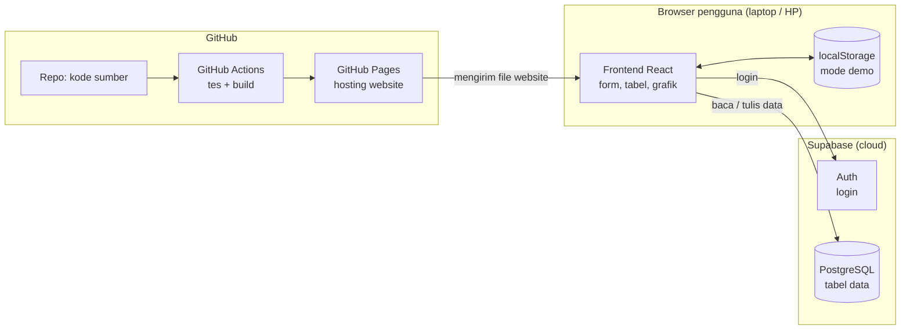
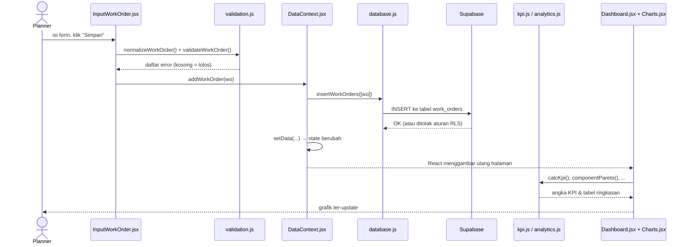
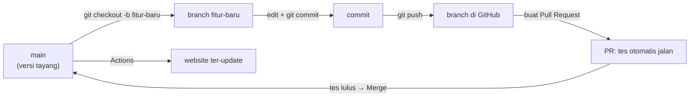

# Panduan Belajar — Fleet Maintenance Dashboard

Panduan ini menjelaskan **cara kerja aplikasi dari ujung ke ujung** memakai kode project ini
sebagai bahan belajar. Ditulis untuk yang sudah paham dasar Python dan Power BI, tapi baru
mulai JavaScript dan web.

**Cara memakai panduan ini:** baca bagian 1–3 untuk gambaran besar, lalu bagian 4 sambil
membuka file yang disebut. Kerjakan latihan di bagian 7 secara berurutan — setiap latihan
hanya menyentuh satu atau dua file.

## Daftar isi

1. [Gambaran besar](#1-gambaran-besar)
2. [Perjalanan satu work order: dari form sampai grafik](#2-perjalanan-satu-work-order-dari-form-sampai-grafik)
3. [Peta file: siapa mengerjakan apa](#3-peta-file-siapa-mengerjakan-apa)
4. [Konsep yang perlu dipahami (dengan contoh dari project ini)](#4-konsep-yang-perlu-dipahami)
5. [Menjalankan project di laptop sendiri](#5-menjalankan-project-di-laptop-sendiri)
6. [Alur kerja Git: branch → commit → pull request → merge](#6-alur-kerja-git-branch--commit--pull-request--merge)
7. [Latihan bertahap](#7-latihan-bertahap)
8. [Urutan belajar & sumber belajar](#8-urutan-belajar--sumber-belajar)
9. [Kamus istilah](#9-kamus-istilah)
10. [Menjelaskan project ini saat interview](#10-menjelaskan-project-ini-saat-interview)

---

## 1. Gambaran besar

Aplikasi ini terdiri dari **tiga bagian** yang tinggal di tempat berbeda:



| Bagian | Isinya | Padanan di Power BI |
|---|---|---|
| **Frontend** (`src/`) | Tampilan yang berjalan di browser: form, tabel, grafik, rumus KPI | Report & visual |
| **Hosting** (GitHub Pages) | Menyimpan file website hasil *build* dan mengirimkannya ke browser | Power BI Service (tempat publish) |
| **Backend** (Supabase) | Database PostgreSQL + login + aturan siapa boleh baca/tulis | Dataset + Row-Level Security |

Hal penting: **rumus KPI dihitung di browser**, bukan di server. Database hanya menyimpan data
mentah (unit, work order, hour meter, log PM). Setiap kali filter berubah, browser menghitung
ulang — persis seperti DAX measure yang dievaluasi ulang saat slicer diklik.

### Dua mode data

| Mode | Data disimpan di | Siapa bisa mengubah | Dipakai untuk |
|---|---|---|---|
| **Database** | Supabase | Hanya akun yang login | Data bersama, "produksi" |
| **Demo** | `localStorage` browser masing-masing | Siapa saja (hanya di browsernya sendiri) | Mencoba aplikasi tanpa merusak data |

Logika pemilihan mode ada di `src/context/DataContext.jsx` (fungsi `connectDatabase` dan `switchSource`).

---

## 2. Perjalanan satu work order: dari form sampai grafik

Ikuti satu WO yang diinput planner sampai muncul di Dashboard. Buka setiap file yang disebut.



### Langkah 1 — Form (`src/pages/InputWorkOrder.jsx`)

Isi form disimpan di *state* React. Saat tombol Simpan diklik, `handleSubmit` berjalan:

```js
async function handleSubmit(event) {
  event.preventDefault();                      // cegah browser me-reload halaman
  const wo = normalizeWorkOrder(form);         // rapikan teks → objek WO
  const found = validateWorkOrder(wo, unitByCode);
  setErrors(found);
  if (Object.keys(found).length > 0) return;   // ada error → berhenti di sini
  setSaving(true);
  try {
    setSavedId(await addWorkOrder(wo));        // simpan, tunggu sampai selesai
    setForm(EMPTY_FORM);                       // kosongkan form
  } catch (e) {
    setErrors({ save: e.message });            // gagal simpan → tampilkan pesan
  }
  ...
}
```

### Langkah 2 — Validasi (`src/lib/validation.js`)

Mirip *cleaning* di Power Query, tapi dilakukan **sebelum** data masuk. Contoh aturannya:
unit harus terdaftar, waktu selesai harus setelah waktu mulai, waktu respon + delay tidak boleh
melebihi lama WO. Fungsi yang sama dipakai juga oleh **Import CSV** — satu aturan, dua pintu masuk.

### Langkah 3 — Simpan (`src/context/DataContext.jsx` → `src/lib/database.js`)

```js
async addWorkOrder(input) {
  requireWrite();                                         // sudah login?
  const id = nextWorkOrderId(data.workOrders, input.start.slice(0, 4));  // WO-2026-0001
  const wo = { ...input, id, siteId: ..., source: 'manual' };
  if (isDatabase) await db.insertWorkOrders([wo]);        // kirim ke Supabase dulu
  setData((d) => ({ ...d, workOrders: [...d.workOrders, wo] }));  // baru tampilkan
  return id;
}
```

`database.js` menerjemahkan nama kolom (`unitCode` di JavaScript ↔ `unit_code` di database)
lalu mengirim perintah INSERT. Supabase memeriksa **aturan RLS** di `supabase/schema.sql`:
pengunjung tanpa login hanya boleh membaca, jadi INSERT-nya ditolak.

### Langkah 4 — Hitung ulang (`src/lib/kpi.js`, `analytics.js`)

`setData` mengubah *state*. React otomatis menggambar ulang semua halaman yang memakai data itu.
Di `Dashboard.jsx`, perhitungan dibungkus `useMemo` supaya hanya dihitung ulang saat data
atau filter benar-benar berubah:

```js
const r = useMemo(() => {
  const { from, to } = periodFromDates(filters.fromDate, filters.toDate);
  const args = { units, workOrders, hmIndex, from, to };
  return { kpi: calcKpi(args), pareto: componentPareto(args), ... };
}, [units, workOrders, hmIndex, filters.fromDate, filters.toDate]);
```

### Langkah 5 — Gambar (`src/components/Charts.jsx`)

Komponen grafik menerima tabel kecil (`[{ name: 'Engine', value: 4725 }, ...]`) dan menggambarnya
dengan library **Recharts**. Batang dengan nilai terburuk diberi warna merah oleh
`HorizontalBarChart` (properti `highlight="max"`).

---

## 3. Peta file: siapa mengerjakan apa

```
fleet-maintenance-dashboard/
├── index.html                 Halaman HTML kosong; React "dipasang" di <div id="root">
├── package.json               Daftar library + perintah (npm run dev / test / build)
├── vite.config.js             Pengaturan alat build (Vite)
├── data/raw/*.xlsx            Data mentah Excel (dataset Power BI)
├── scripts/convert_excel.py   Python: Excel → src/data/site-a.json
├── supabase/schema.sql        SQL: tabel, hak akses (RLS), peran admin/user
├── docs/                      Dokumentasi (KPI, audit UI, panduan ini)
├── .github/workflows/         GitHub Actions: tes → build → publish
└── src/
    ├── main.jsx               Titik masuk: memasang <App /> ke halaman
    ├── App.jsx                Daftar halaman: alamat (#/dashboard) → komponen
    ├── styles.css             Seluruh tampilan: warna (token), layout, tema, versi cetak
    ├── context/
    │   └── DataContext.jsx    "Gudang" data bersama + semua aksi simpan
    ├── data/
    │   ├── catalog.js         Daftar istilah: jenis WO, status, komponen, alasan delay
    │   ├── site-a.json        Data Site A hasil konversi Excel
    │   ├── siteB.js           Generator data dummy Site B
    │   ├── simulate.js        Alat bantu: angka acak ber-seed, simulasi HM harian
    │   └── seed.js            Menggabungkan Site A + Site B jadi satu dataset
    ├── lib/                   LOGIKA (tanpa tampilan) — paling penting dipahami
    │   ├── kpi.js             Rumus PA, MA, UA, MTBF, MTTR, downtime, HM
    │   ├── analytics.js       Tabel untuk grafik: pareto, heatmap, delay, rincian MTTR
    │   ├── planning.js        Forecast PM, compliance, backlog, ringkasan unit
    │   ├── report.js          Laporan mingguan + kesimpulan otomatis
    │   ├── validation.js      Aturan validasi input
    │   ├── database.js        Komunikasi dengan Supabase
    │   ├── storage.js         Simpan/baca localStorage (mode demo)
    │   ├── csv.js             Baca & tulis CSV
    │   ├── format.js          Format angka/tanggal gaya Indonesia
    │   └── kpi.test.js        Tes otomatis untuk rumus-rumus di atas
    ├── components/            Potongan tampilan yang dipakai ulang
    │   ├── Layout.jsx         Header + menu samping
    │   ├── Charts.jsx         Grafik batang, garis, bertumpuk, sparkline
    │   ├── Heatmap.jsx        Heatmap ketersediaan armada
    │   ├── KpiCard.jsx        Kartu KPI
    │   ├── Unit360.jsx        Jendela detail unit
    │   └── ...
    └── pages/                 Satu file = satu menu
        ├── Home.jsx           Beranda (alur kerja)
        ├── InputWorkOrder.jsx · HourMeter.jsx · ImportCenter.jsx     (Langkah 1)
        ├── WorkOrders.jsx · Backlog.jsx · EquipmentHealth.jsx         (Langkah 2)
        ├── Dashboard.jsx · PmPlanning.jsx · Report.jsx                (Langkah 3)
        └── DatabasePage.jsx · Units.jsx                               (Pengaturan)
```

**Aturan praktis:** `lib/` berisi *logika murni* (masuk data, keluar angka — bisa dites tanpa
browser). `pages/` dan `components/` berisi *tampilan*. Memisahkan keduanya membuat rumus
mudah dites dan tampilan mudah diganti.

---

## 4. Konsep yang perlu dipahami

### 4.1 JavaScript dibanding Python

Anda sudah kenal Python — sebagian besar konsepnya sama, hanya beda tulisan.

| Konsep | Python | JavaScript |
|---|---|---|
| Variabel | `pa = 85.4` | `const pa = 85.4;` (`let` bila nilainya akan diubah) |
| Fungsi | `def mtbf(op, bd): return op / bd` | `function mtbf(op, bd) { return op / bd; }` atau `const mtbf = (op, bd) => op / bd;` |
| List / array | `units = ["EX-001", "DT-001"]` | `const units = ['EX-001', 'DT-001'];` |
| Dictionary / objek | `{"code": "EX-001", "type": "Excavator"}` | `{ code: 'EX-001', type: 'Excavator' }` |
| Filter | `[w for w in wos if w["type"] == "BM"]` | `wos.filter((w) => w.type === 'BM')` |
| Map | `[w["cost"] for w in wos]` | `wos.map((w) => w.cost)` |
| Sum | `sum(w["cost"] for w in wos)` | `wos.reduce((s, w) => s + w.cost, 0)` |
| f-string | `f"PA {pa}%"` | `` `PA ${pa}%` `` (tanda backtick) |
| None | `None` | `null` (atau `undefined`) |
| Sama dengan | `==` | `===` (selalu pakai tiga tanda) |
| Import | `from kpi import calc_kpi` | `import { calcKpi } from './kpi.js';` |

Pola `filter → map → reduce` dipakai di hampir semua rumus `src/lib/`. Contoh nyata dari
`kpi.js` (total biaya WO dalam periode):

```js
cost: inPeriod.reduce((sum, wo) => sum + (wo.cost || 0), 0),
```

**Async/await** (mirip `asyncio` di Python): operasi yang butuh waktu (mengirim data ke
Supabase) ditandai `async`, dan pemanggilnya menunggu dengan `await`. Lihat `addWorkOrder`.

### 4.2 React: komponen, props, state

- **Komponen** = fungsi yang mengembalikan tampilan (JSX, mirip HTML di dalam JavaScript).
  Contoh paling sederhana: `src/components/PageHeader.jsx`.
- **Props** = input komponen. `<KpiCard label="MTBF" value={129.7} ... />` → di dalam
  `KpiCard.jsx` dibaca sebagai `({ label, value })`.
- **State** = data yang bisa berubah dan memicu tampilan digambar ulang:
  `const [form, setForm] = useState(EMPTY_FORM);` Ubah dengan `setForm(...)`, **jangan**
  mengubah `form` langsung.
- **useMemo** = simpan hasil hitungan berat, hitung ulang hanya bila input berubah
  (seperti cache measure).
- **useEffect** = jalankan sesuatu *setelah* tampil, mis. menyimpan ke localStorage setiap data
  berubah (`DataContext.jsx`).
- **Context** = data bersama untuk semua halaman tanpa dioper satu per satu. Halaman cukup
  memanggil `const { workOrders, addWorkOrder } = useData();`.

### 4.3 Routing (pindah halaman)

`src/App.jsx` memetakan alamat ke halaman: `#/dashboard` → `<Dashboard />`. Tanda `#` dipakai
karena GitHub Pages hanya bisa menyajikan file statis (lihat komentar di `src/main.jsx`).

### 4.4 CSS: token warna, grid, dan media query

- Semua warna didefinisikan sekali sebagai **token** di awal `src/styles.css`
  (`--text-primary`, `--critical`, ...). Tema gelap hanya mengganti nilai token, bukan setiap elemen.
- Layout memakai **CSS Grid** (`.kpi-grid`, `.grid-2`) dan **Flexbox** (`.filters`).
- `@media (max-width: 640px)` = aturan khusus layar HP. `@media print` = aturan saat dicetak
  (dipakai Laporan Mingguan).

### 4.5 Database & SQL

Tabel ada di `supabase/schema.sql`. Coba query ini di **SQL Editor** Supabase:

```sql
-- 10 WO terbaru
select id, unit_code, type, status, start_at from work_orders order by start_at desc limit 10;

-- Jumlah breakdown per tipe unit (mirip measure COUNTROWS + FILTER di DAX)
select u.type, count(*) as breakdown
from work_orders w join units u on u.code = w.unit_code
where w.type in ('BM', 'BAC')
group by u.type order by breakdown desc;

-- Rata-rata waktu respon per unit (Site B)
select unit_code, round(avg(response_hours), 1) as respon_jam
from work_orders where response_hours is not null
group by unit_code order by respon_jam desc;
```

**Row Level Security (RLS)** = aturan per baris tentang siapa boleh membaca/menulis. Di project
ini: semua orang boleh membaca, akun login boleh menambah WO, hanya admin boleh mengubah master
unit. Fungsi `is_admin()` memeriksa tabel `profiles`.

**Publishable key** di `src/lib/database.js` memang aman berada di kode website — yang menjaga
data adalah RLS. Yang **tidak boleh** dibagikan: `service_role key` dan password database.

### 4.6 Tes otomatis

`src/lib/kpi.test.js` berisi contoh kecil dengan jawaban yang sudah dihitung manual, misalnya:

> 1 unit, 10 hari (240 jam), 1 breakdown 10 jam + 1 PM 5 jam, HM naik 10 jam/hari
> → PA = 225/240 = 93,75%, MTBF = 100 jam, MTTR = 10 jam.

Jalankan `npm test`. Bila Anda mengubah rumus dan tes gagal, artinya hasilnya berubah —
periksa apakah memang disengaja. Ini sama seperti cross-check DAX dengan sheet
`Summary_Bulanan` di Excel Anda.

### 4.7 Build & publish otomatis

`.github/workflows/deploy.yml` berjalan setiap ada perubahan di `main`:

1. `npm ci` — pasang library persis sesuai `package-lock.json`
2. `npm test` — jalankan tes; bila gagal, proses berhenti (website lama tetap tayang)
3. `npm run build` — Vite menggabungkan & mengecilkan kode ke folder `dist/`
4. Publish `dist/` ke GitHub Pages

---

## 5. Menjalankan project di laptop sendiri

1. Install **[Node.js](https://nodejs.org/)** versi 22 (LTS), **[Git](https://git-scm.com/)**, dan
   **[VS Code](https://code.visualstudio.com/)**.
2. Buka terminal (di VS Code: menu *Terminal → New Terminal*), lalu:

   ```bash
   git clone https://github.com/rizkysugiharto-eng/fleet-maintenance-dashboard.git
   cd fleet-maintenance-dashboard
   npm install        # sekali saja, mengunduh library ke folder node_modules
   npm run dev        # buka alamat yang muncul, biasanya http://localhost:5173
   ```

3. Ubah sebuah file (mis. teks di `src/pages/Home.jsx`) lalu simpan — browser otomatis
   menampilkan perubahan tanpa reload.
4. Sebelum mengirim perubahan, jalankan `npm test` dan `npm run build`.

Tips VS Code: pasang ekstensi **ES7+ React snippets** dan **Prettier**; tekan `Ctrl+P` untuk
membuka file dengan cepat, `F12` untuk melompat ke definisi fungsi.

---

## 6. Alur kerja Git: branch → commit → pull request → merge

Inilah alur yang dipakai untuk setiap perubahan di project ini (lihat riwayat PR di tab **Pull requests** GitHub).



Langkah per langkah:

```bash
git checkout main && git pull            # 1. ambil versi terbaru
git checkout -b ubah-target-pa           # 2. buat branch untuk satu perubahan
# ... edit file ...
npm test && npm run build                # 3. pastikan tidak ada yang rusak
git add src/lib/kpi.js                   # 4. pilih file yang diubah
git commit -m "Ubah target PA menjadi 90%"   # 5. simpan dengan pesan yang jelas
git push -u origin ubah-target-pa        # 6. kirim branch ke GitHub
```

7. Buka repo di GitHub → muncul tombol **Compare & pull request** → isi judul & penjelasan →
   **Create pull request**.
8. Tunggu tanda centang hijau ✓ (tes otomatis lulus). Bila merah ✗, klik **Details** untuk
   melihat penyebabnya.
9. Klik **Merge pull request** → **Confirm merge**. Sekitar 1 menit kemudian website ter-update.

Kenapa tidak langsung edit di `main`? Karena PR memberi kesempatan tes berjalan **sebelum**
perubahan tayang, dan riwayatnya mudah ditelusuri.

### Contoh nyata: memperbaiki bug filter Periode (PR #4)

Laporan pengguna: *"di Detail unit → Hour Meter, filter Periode 30 hari tidak berpengaruh."*
Begini cara menelusurinya:

1. **Cari sumbernya.** Judul modal "Detail unit" → `grep -rn "Detail unit" src` → `src/components/Unit360.jsx`.
2. **Ikuti datanya.** Pilihan periode disimpan di `period` → dihitung jadi `from`.
   Grafik HM memakai `hmSeries`, yang ternyata **tidak memakai `from` sama sekali**:

   ```js
   // sebelum: selalu semua titik HM
   return (hmIndex.get(unit.code) ?? []).slice(1).filter(/* tiap 7 hari */)
   ```

3. **Cek tempat lain dengan pola sama.** Riwayat WO (`unitSummary().history`) dan KPI Bulanan
   juga mengabaikan periode → diperbaiki sekalian.
4. **Perbaiki:** saring titik HM dengan `p.t - DAY >= from`; periode pendek per hari, panjang per minggu.
   Jangan lupa tambahkan `from` ke daftar dependensi `useMemo`, kalau tidak grafik tidak ikut berubah.
5. **Uji:** `npm test`, `npm run build`, lalu cek di browser untuk 30 hari, 365 hari, dan Semua.
6. **Branch → commit → PR → merge** seperti langkah di atas.

Pelajaran: bug "filter tidak jalan" hampir selalu berarti nilai filter **tidak dipakai** di
perhitungan, atau **tidak masuk** daftar dependensi `useMemo`.

---

## 7. Latihan bertahap

Kerjakan berurutan. Setiap latihan: buat branch → ubah → `npm test` → lihat di browser → PR.

| # | Latihan | File | Yang dipelajari |
|---|---|---|---|
| 1 | Ubah teks penjelasan di Beranda | `src/pages/Home.jsx` | Struktur JSX, hot reload |
| 2 | Ubah target PA dari 85% menjadi 90%. Perhatikan kartu KPI & tabel berubah warna/status | `src/lib/kpi.js` (`TARGETS`) | Konstanta dipakai banyak tempat |
| 3 | Tambah alasan delay baru "Menunggu operator" | `src/data/catalog.js` (`DELAY_REASONS`) | Data master → otomatis muncul di form & filter |
| 4 | Tambah kolom "Tipe" di tabel Backlog | `src/pages/Backlog.jsx` | Membaca data unit lewat `unitByCode` |
| 5 | Tulis tes baru: PA harus 100% bila tidak ada WO | `src/lib/kpi.test.js` | Menulis tes dengan Vitest |
| 6 | Tambah KPI "Biaya per jam operasi (Rp/HM)" di `calcKpi` dan tampilkan di Dashboard | `kpi.js`, `Dashboard.jsx` | Rumus baru dari hulu ke hilir |
| 7 | Tambah grafik "Breakdown per shift (siang/malam)" | `analytics.js`, `Dashboard.jsx` | Mengelompokkan data, memakai `HorizontalBarChart` |
| 8 | Tambah kolom `shift` di database lalu isi dari form | `schema.sql`, `database.js`, `InputWorkOrder.jsx`, `validation.js` | Perubahan end-to-end: database → form → validasi |

**Petunjuk latihan 6:** di `calcKpi` sudah ada `operatingHours` dan `cost`.
Tambahkan `costPerHm: operating > 0 ? cost / operating : null` ke objek yang dikembalikan,
lalu buat `KpiCard` baru di `Dashboard.jsx`. Jangan lupa tes!

**Petunjuk latihan 7:** pakai `new Date(wo.start).getHours()` — jam 06–17 = siang, lainnya malam.
Contoh pola pengelompokan ada di fungsi `sumBy` pada `analytics.js`.

---

## 8. Urutan belajar & sumber belajar

Urutan yang disarankan (± 6–8 minggu, 1 jam/hari):

| Minggu | Topik | Sumber (gratis) |
|---|---|---|
| 1 | Dasar JavaScript: variabel, fungsi, array, objek | [javascript.info](https://javascript.info/) bagian 1 · [MDN JavaScript Guide](https://developer.mozilla.org/id/docs/Web/JavaScript/Guide) |
| 2 | Array method (`map`, `filter`, `reduce`), async/await | javascript.info bab *Arrays* & *Promises, async/await* |
| 3 | HTML & CSS dasar, Flexbox, Grid | [MDN Learn web development](https://developer.mozilla.org/en-US/docs/Learn) · [Flexbox Froggy](https://flexboxfroggy.com/) · [Grid Garden](https://cssgridgarden.com/) |
| 4 | React: komponen, props, state | [react.dev/learn](https://react.dev/learn) (Quick Start + *Thinking in React*) |
| 5 | Git & GitHub | [Learn Git Branching](https://learngitbranching.js.org/) · [GitHub Skills](https://skills.github.com/) |
| 6 | SQL dasar | [SQLBolt](https://sqlbolt.com/) · [Supabase Docs: Database](https://supabase.com/docs/guides/database/overview) |
| 7 | Supabase Auth & RLS | [Supabase Docs: Row Level Security](https://supabase.com/docs/guides/database/postgres/row-level-security) |
| 8 | Grafik & tes | [Recharts examples](https://recharts.org/en-US/examples) · [Vitest Guide](https://vitest.dev/guide/) |

Kursus lengkap terstruktur (opsional): [freeCodeCamp — JavaScript Algorithms and Data Structures](https://www.freecodecamp.org/learn)
dan [The Odin Project — Full Stack JavaScript](https://www.theodinproject.com/paths/full-stack-javascript).

**Cara belajar paling efektif dengan project ini:** setiap selesai satu topik, cari contohnya di
kode project (pakai `Ctrl+Shift+F` di VS Code, mis. cari `.reduce(` atau `useState`), baca
komentar di atasnya, lalu kerjakan latihan yang relevan di bagian 7.

---

## 9. Kamus istilah

| Istilah | Arti singkat |
|---|---|
| **Frontend** | Bagian aplikasi yang berjalan di browser (tampilan + logika di `src/`) |
| **Backend** | Server & database (di project ini: Supabase) |
| **Full-stack** | Mengerjakan frontend dan backend sekaligus |
| **Komponen** | Potongan tampilan React yang bisa dipakai ulang |
| **State** | Data yang bisa berubah dan membuat tampilan digambar ulang |
| **Props** | Input yang dikirim ke komponen |
| **Hook** | Fungsi React berawalan `use` (`useState`, `useMemo`, `useEffect`) |
| **Build** | Proses mengubah kode sumber menjadi file website siap tayang (`dist/`) |
| **Deploy / publish** | Mengunggah hasil build ke hosting |
| **CI (Continuous Integration)** | Tes & build otomatis setiap ada perubahan (GitHub Actions) |
| **Branch** | Salinan kerja terpisah untuk satu perubahan |
| **Commit** | Satu titik simpan perubahan beserta pesannya |
| **Pull request (PR)** | Permintaan menggabungkan branch ke `main`, tempat review & tes |
| **Merge** | Menggabungkan perubahan ke `main` |
| **API** | Cara program berbicara dengan program lain (aplikasi ↔ Supabase) |
| **RLS** | Row Level Security — aturan akses per baris di database |
| **localStorage** | Penyimpanan kecil di browser, dipakai mode demo |
| **Seed data** | Data awal/contoh untuk mengisi aplikasi |
| **Token (CSS)** | Variabel warna/ukuran yang dipakai di seluruh tampilan |

---

## 10. Menjelaskan project ini saat interview

Kerangka 1 menit:

> "Saya membangun aplikasi web end-to-end untuk monitoring maintenance alat berat, pengembangan
> dari dashboard Power BI saya. Planner menginput work order dan hour meter lewat form yang
> tervalidasi; data disimpan di database PostgreSQL (Supabase) dengan login dan hak akses per
> peran. Aplikasi menghitung PA, MA, UA, MTBF, dan MTTR secara otomatis, memecah MTTR menjadi
> waktu respon, menunggu part, dan pengerjaan, serta membuat laporan mingguan siap cetak.
> Setiap perubahan dites otomatis dan dipublikasikan lewat GitHub Actions."

Poin yang menunjukkan pemahaman maintenance (siapkan contohnya dari dashboard):

- **Definisi KPI yang benar** — kenapa PA dihitung terhadap jam kalender, bukan jam operasi
  (lihat `docs/KPI.md`, bagian perbedaan dengan rumus Excel lama).
- **MTTR tinggi itu karena apa?** — dari rincian waktu perbaikan: porsi menunggu part 41% →
  rekomendasi stok part kritis; respon lambat di shift malam → mekanik standby.
- **PM compliance vs completion rate** — PM bisa "selesai" tapi terlambat secara HM.
- **Data quality** — validasi HM tidak boleh turun / > 24 jam per hari; WO yang tumpang tindih
  tidak dihitung dua kali.
- **"Kok PA-nya cuma 61,5%?"** (dashboard Power BI) — siapkan jawaban ini:
  > "Itu sengaja saya buat rendah supaya ada masalah yang bisa dianalisis. Dari dashboard
  > kelihatan Breakdown Maintenance menyumbang 41,6% downtime dan BD-001 MTBF-nya paling rendah,
  > jadi itu prioritas pertama yang saya kejar. Di versi web, PA Site A jadi 93,9% karena saya
  > ganti ke rumus standar yang membagi dengan jam kalender, tetapi MTTR-nya tetap 15,6 jam,
  > di atas target 12 jam."

Poin teknis:

- Logika dipisah dari tampilan (`src/lib/`) sehingga rumus bisa dites (18 tes otomatis).
- Keamanan memakai RLS di database, bukan hanya menyembunyikan tombol di tampilan.
- Aksesibilitas: kontras warna sesuai WCAG, status selalu ikon + teks, setiap grafik punya
  tampilan tabel (lihat `docs/UI-AUDIT.md`).
